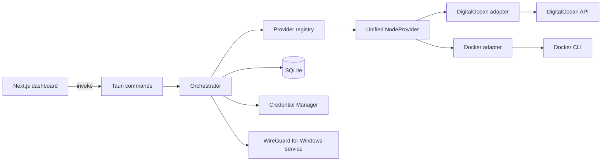

# Architecture

## Overview

GoatStare is a desktop control plane for running user-owned WireGuard VPN infrastructure through provider adapters and a unified NodeProvider interface.

Stack:

- Next.js + React frontend for operator workflows
- Tauri command bridge for typed frontend/backend calls
- Rust backend for orchestration, provider adapters, lifecycle state, and diagnostics
- SQLite for local metadata and runtime snapshots
- Windows Credential Manager for secret storage
- WireGuard for Windows on the machine running the app; tunnels are managed through its service.

Included provider adapters:

- DigitalOcean adapter for cloud VPS lifecycle
- Docker adapter for local container-backed development workflows

## System Diagram

## Core Responsibilities

- Frontend: user workflows for provider, node, tunnel, health, and diagnostics.
- Command layer: typed boundary and error mapping.
- Orchestrator: lifecycle transitions, idempotency, reconciliation, cleanup.
- Provider registry: adapter resolution by provider slug and NodeProvider construction.
- NodeProvider: provider-neutral lifecycle contract for init, bootstrap readiness, status, existence checks, and delete.
- Provider adapters: low-level provider implementation details for validate, catalog, create, wait, and delete.
- WireGuard manager: generate keys, and import, activate, deactivate, and unregister tunnels through the WireGuard for Windows service.
- Key management: generate and store key material on the app host; never generate client keys on remote nodes.

## Connection Model

- There is one connection path: the WireGuard for Windows tunnel service.
- Elevation is requested for connect and disconnect only, and only after a direct attempt is refused for permissions. Status reads never elevate.
- An earlier `Admin Mode` / `User Mode` toggle was removed. It promised a second, in-process adapter runtime that could not work — the adapter was destroyed when its creating function returned, and interface reads always failed for want of an adapter handle — so Admin Mode silently fell back to the service path and the two modes were identical in practice.

## Global App Settings

Desktop-wide runtime settings are persisted in SQLite through a dedicated `app_settings` table owned by the Rust backend.

Rules:

- The backend is the source of truth for global runtime settings used during tunnel lifecycle operations.
- The frontend reads and updates these settings only through typed Tauri commands.
- Settings must be additive, versioned through migrations, and safe for existing installs.
- Secret values must not be stored in app settings.

The table holds `current_node_id`: the node the app connects to by default. It is written on a
successful connect and when the user picks a server, validated against the node list on read, and
cleared when its node is destroyed. This is a fourth status axis, deliberately separate from the
three below — "the server I mean" is not the same fact as "the VM is on", "the app finished
provisioning it", or "a tunnel is up right now". See `docs/DB_SCHEMA.md` for the exact semantics.

It previously also held `wireguard_connection_mode`, removed in migration 0014 along with the
connection-mode toggle (see Connection Model above).

## Unified NodeProvider Contract

The orchestrator and command layer operate against a shared NodeProvider abstraction instead of reaching directly into provider-specific execution paths.

The contract covers:

- `list_regions` / `describe_region`: report where a region physically is, normalized to
  `ProviderRegion { slug, city, area, country, country_code, continent }`. Every geography field is
  optional: a slug the adapter does not recognise carries no location rather than an invented one,
  and callers render the slug. `describe_region` answers without a token or a network call, because
  a node row stores only a slug and the fleet list must stay readable when a provider key goes bad.
  Region slugs are provider namespaces, so the mapping lives inside each adapter — a shared table
  keyed by slug alone would collide as soon as two providers use the same code.
- `init`: provision a node, persist the bootstrapping context, and return a bootstrap contract preview.
- `wait_for_bootstrap_ready`: wait until the provider reports the node usable and resolve the endpoint. Nothing is read back from the node itself; the server public key is already known locally.
- `get_status`: report the provider-level node status in a normalized form.
- `exists`: check whether the node still exists.
- `delete`: tear down the provider-side node resource.

The registry resolves the correct provider adapter, loads the provider token from secure storage, and presents that provider through the shared NodeProvider interface to the orchestrator.

## Lifecycle Model

### Node states

- `new`
- `provisioning`
- `bootstrapping`
- `ready`
- `connected`
- `error`
- `deleting`

### Tunnel states

- `new`
- `ready`
- `connected`
- `disconnected`
- `error`
- `deleting`

State changes are validated in backend transition guards.

## Trust Boundaries

- Frontend input boundary: all command inputs are treated as untrusted.
- Secret boundary: secure storage keeps secret values out of SQLite.
- Provider boundary: remote API responses are validated and normalized.
- Local runtime boundary: `wireguard.exe`, `sc`, `wg`, and Docker command output are treated as untrusted process output.

## Data Flow

1. Register and validate provider credentials.
2. Fetch region and pricing catalog.
3. Verify WireGuard for Windows is installed on the app host.
4. Generate WireGuard keypair on the app host (where the app resides) and persist secrets locally.
5. Provision node with an init script that receives and applies the generated public key.
6. Wait until the provider reports the node ready, and record the endpoint it reports.
7. Configure and activate the client tunnel locally through the WireGuard tunnel service.
8. Poll health and diagnostics.
9. Disconnect, destroy, or force-cleanup as required.

## Key Generation And Bootstrap Requirements

- Key generation location: WireGuard key generation must happen on the same machine where the app runs. Both keypairs — server and client — are generated before the node is created.
- Host dependency: the app host must have WireGuard for Windows installed. No driver DLL is bundled or downloaded.
- Private key handling: private key material remains local to the app host and secure storage boundary. The server's private key is written into the payload; the client's never leaves the machine.
- Public key propagation: the client's public key is baked into the server's `[Peer]` block at render time, so the node boots already knowing its peer. There is no second round-trip to register it.
- Node bootstrap contract: the init script applies the supplied keys during first boot and never generates its own.
- Verification: the node writes a readiness marker as a self-check and debugging aid. The app never reads it — doing so would require a channel into the node that the contract forbids.

### Readiness is provider-observable only

A provider reports a node usable before its first-boot script has finished. A DigitalOcean droplet
is `active` once the VM is running, which is well before cloud-init has installed WireGuard.

The app cannot close that gap without a channel into the node, so it does not try. The tunnel is
configured as soon as the endpoint is known, and WireGuard re-sends handshake initiations every few
seconds until the server answers. A tunnel connected immediately after provisioning may therefore
show no handshake for a short warm-up period, then complete on its own.

This is why "connected" and "carrying traffic" are reported as separate facts: service state comes
from `sc query`, and a handshake is only observable once the peer actually responds.

## Reliability Patterns

- Idempotent cleanup semantics for partial failures.
- Startup reconciliation for stale local/remote state.
- Explicit recovery flows in the UI for provider and local WireGuard runtime failures.
- **Errors are reported with their cause chain.** `thiserror`'s `Display` prints only the outermost
  message, so a `#[source]` was invisible in logs, in `error_reason`, and in the UI. Anything that
  logs or surfaces an error must flatten the chain through
  `backend::logging::describe_error_chain`, which also redacts. A provisioning failure that reports
  only "Node creation or bootstrap setup failed" is not diagnosable by the user or by whoever reads
  the logs afterwards.
- **Provider naming rules belong to the adapter.** A node name is free text chosen by the user;
  DigitalOcean requires a droplet name that is a valid hostname. The adapter maps between them
  rather than constraining what a node may be called, and the local record keeps the user's label.
