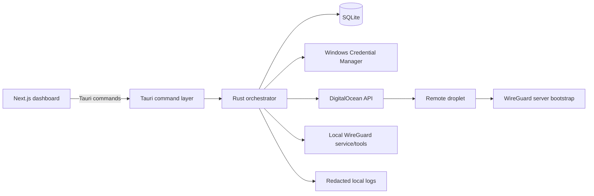

# Architecture

## Overview

GoatStare VPN Phase 1 is a Windows desktop control plane for a single DigitalOcean-backed WireGuard deployment. The implementation is split across:

- Rust backend for orchestration, persistence, secret handling, and local WireGuard service control
- Tauri command layer for typed UI calls
- Next.js frontend for operator workflows
- SQLite for node, tunnel, provider, and runtime state
- Windows Credential Manager for secret storage

Phase 1 is intentionally narrow: Windows only, DigitalOcean only, WireGuard only.

## Component Diagram

### Responsibilities

- UI: collect provider credentials, show node health, and expose connect/disconnect/destroy/force-cleanup actions.
- Tauri commands: translate UI inputs into typed backend calls and map backend errors to displayable strings.
- Orchestrator: owns the state machine and idempotent workflows.
- Provider adapter: validates tokens, provisions droplets, polls for readiness, and deletes droplets.
- WireGuard manager: installs/imports/activates/deactivates/unregisters local tunnel services.
- Secure storage: stores DO API tokens and client private keys locally without writing plaintext to SQLite.
- Database: stores providers, nodes, tunnels, and runtime snapshots.

## Data Flow

### Token -> Provision -> Connect

1. Operator enters a DigitalOcean token in the UI.
2. Backend stores the token in secure storage and persists only a token_ref in SQLite.
3. Operator creates a node.
4. Orchestrator renders cloud-init, provisions a droplet, waits for it to become active, and records the droplet id/IP/public key.
5. Orchestrator generates a client keypair locally and imports a tunnel into WireGuard.
6. Orchestrator activates the tunnel and verifies runtime status.
7. Health queries read local runtime state and store handshake/traffic snapshots in SQLite.

### Destroy / Force Cleanup

1. Operator destroys a node or triggers force cleanup.
2. Backend deactivates and unregisters any local tunnels.
3. Backend best-effort deletes the remote droplet when a droplet reference is available.
4. Backend removes local tunnel and node rows.
5. Secrets are deleted from Credential Manager when references are no longer needed.

## Trust Boundaries

- UI to backend: untrusted input boundary; all command inputs are validated before they hit stateful operations.
- Backend to Windows Credential Manager: trusted local secret boundary; secret values never belong in SQLite.
- Backend to DigitalOcean API: remote trust boundary over HTTPS; no certificate pinning in Phase 1.
- Backend to local WireGuard tools/services: privileged local boundary; failures are treated as recoverable and idempotent where possible.
- SQLite: local metadata only; do not store plaintext API tokens or private keys.

## State Machine Overview

### Node lifecycle

- `new` -> `provisioning`
- `provisioning` -> `bootstrapping`
- `bootstrapping` -> `ready`
- `ready` -> `connected`
- `connected` -> `ready`
- Any of `provisioning`, `bootstrapping`, `ready`, `connected` -> `error`
- `error` -> `deleting`
- `ready` or `connected` -> `deleting`

### Tunnel lifecycle

- `new` -> `ready`
- `ready` -> `connected`
- `connected` -> `disconnected`
- `disconnected` -> `connected`
- Any active state -> `error`
- Any non-deleting state -> `deleting`

### Operational notes

- Idempotent reruns are preferred when the current state can be proven safe.
- Force cleanup is the escape hatch for partial provisioning or interrupted startup.
- Startup reconciliation repairs stale status and flags drift for operator review.

## Assumptions

- TODO: project-specific fill if the droplet-side bootstrap channel changes in a later phase.
- TODO: project-specific fill if a signed installer introduces additional launch-time checks.
