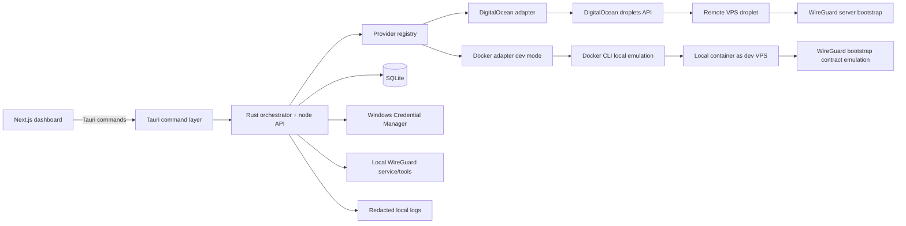

# Architecture

## Overview

GoatStare VPN Phase 1 is a Windows desktop control plane for running a user-owned WireGuard VPN on a VPS provider through a unified provider abstraction.

High-level product goal:

- User enters a provider API key.
- App provisions a VPS.
- App installs and configures WireGuard.
- User connects securely through the local WireGuard client.

Project inspiration:

- https://www.digitalocean.com/solutions/vpn

The implementation is split across:

- Rust backend for orchestration, persistence, secret handling, and local WireGuard service control
- Tauri command layer for typed UI calls
- Next.js frontend for operator workflows
- SQLite for node, tunnel, provider, and runtime state
- Windows Credential Manager for secret storage

Phase 1 is intentionally narrow in platform/security surface (Windows + WireGuard), but already uses a multi-provider architecture.

- Production provider adapter: DigitalOcean.
- Development-only adapter: Docker emulator with synthetic responses and local container-backed node simulation.

## Component Diagram

### Responsibilities

- UI: collect provider credentials, show provider/node health, and expose node/tunnel lifecycle operations.
- Tauri commands: translate UI inputs into typed backend calls and map backend errors to displayable strings.
- Orchestrator: owns lifecycle state machines, generalized node workflows, and idempotent operations.
- Provider registry: resolves provider slug -> adapter and enforces capability routing.
- Provider adapters: normalize provider APIs behind a shared contract (token validation, region/plan catalog, create/wait/delete lifecycle calls).
- WireGuard manager: installs/imports/activates/deactivates/unregisters local tunnel services.
- Secure storage: stores provider API tokens and client private keys locally without writing plaintext to SQLite.
- Database: stores providers, nodes, tunnels, and runtime snapshots.

## Generalized Node Management API (Architecture Contract)

The backend is documented as a provider-neutral node management API. Adapters implement provider-specific translation.

Core operation categories:

- `create`: create/provision a node and return provider external reference + endpoint metadata.
- `edit`: update mutable node settings (label/plan/region where provider supports it).
- `suspend` / `resume`: pause and reactivate provider usage at provider or node scope.
- `delete`: remove remote node and local metadata with idempotent cleanup semantics.
- `get_system_info`: fetch runtime/system facts used by health and diagnostics views.
- `list` / `get`: retrieve normalized local state for nodes and provider attachments.

Phase 1 implementation status:

- Implemented and used: provider validate, region/pricing list, create-to-ready, delete, list/get, health/system info.
- Implemented at provider scope: suspend/resume provider state.
- Partially implemented for node scope: edit/suspend/resume semantics are defined at architecture level and expanded in follow-up iterations.

DigitalOcean API reference used for provider modeling:

- https://docs.digitalocean.com/reference/api/reference/droplets/

## Data Flow

### Token -> Provision -> Connect

1. Operator enters a provider token in the UI.
2. Backend stores the token in secure storage and persists only a token_ref in SQLite.
3. Operator selects provider and creates a node.
4. Orchestrator resolves adapter by provider slug, renders bootstrap input, provisions the provider node, waits for active/readiness, and records external id/IP/public key.
5. Orchestrator generates a client keypair locally and imports a tunnel into WireGuard.
6. Orchestrator activates the tunnel and verifies runtime status.
7. Health queries read local runtime state and store handshake/traffic snapshots in SQLite.

### Dev Mode Token -> Provision (Docker Emulator)

1. Developer enables `GOATSTARE_DEV_DOCKER=1`.
2. Developer registers a faux token for provider id `provider-docker` (token prefix `dkr_v1_` or `docker_`).
3. Docker adapter validates local Docker CLI/daemon readiness.
4. Create-node flow allocates a container as a VPS analogue and returns synthetic provider metadata.
5. Bootstrap readiness returns contract-shaped dummy output to keep orchestrator behavior identical to cloud path.

### Destroy / Force Cleanup

1. Operator destroys a node or triggers force cleanup.
2. Backend deactivates and unregisters any local tunnels.
3. Backend best-effort deletes the remote provider resource when an external reference is available.
4. Backend removes local tunnel and node rows.
5. Secrets are deleted from Credential Manager when references are no longer needed.

## Trust Boundaries

- UI to backend: untrusted input boundary; all command inputs are validated before they hit stateful operations.
- Backend to Windows Credential Manager: trusted local secret boundary; secret values never belong in SQLite.
- Backend to provider APIs: remote trust boundary over HTTPS for cloud adapters; no certificate pinning in Phase 1.
- Backend to Docker runtime in dev mode: local tooling boundary; outputs are treated as untrusted process output.
- Backend to local WireGuard tools/services: privileged local boundary; failures are treated as recoverable and idempotent where possible.
- SQLite: local metadata only; do not store plaintext API tokens or private keys.

## State Machine Overview

### Node lifecycle

- `new` -> `provisioning`
- `provisioning` -> `bootstrapping`
- `bootstrapping` -> `ready`
- `ready` -> `connected`
- `connected` -> `ready`
- Any of `provisioning`, `bootstrapping`, `ready`, `connected` -> `error`
- `error` -> `deleting`
- `ready` or `connected` -> `deleting`

### Tunnel lifecycle

- `new` -> `ready`
- `ready` -> `connected`
- `connected` -> `disconnected`
- `disconnected` -> `connected`
- Any active state -> `error`
- Any non-deleting state -> `deleting`

### Operational notes

- Idempotent reruns are preferred when the current state can be proven safe.
- Force cleanup is the escape hatch for partial provisioning or interrupted startup.
- Startup reconciliation repairs stale status and flags drift for operator review.

## Assumptions

- Provider adapters converge on a common normalized node contract even when provider-native APIs differ.
- Docker provider remains dev-only and is not treated as a production security boundary.
