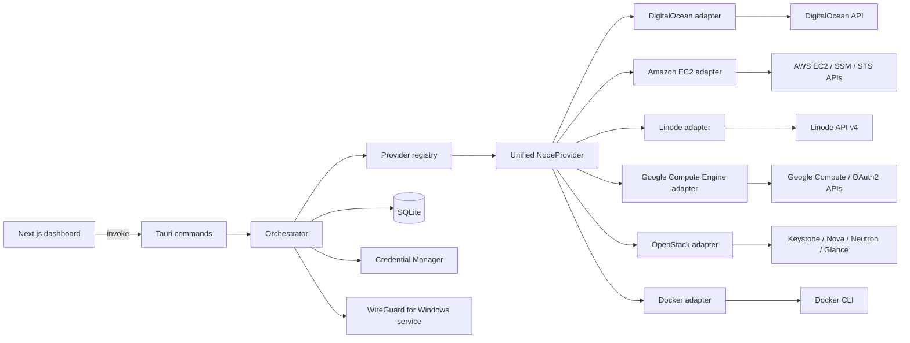

# Architecture

## Overview

Blink is a desktop control plane for running user-owned WireGuard VPN infrastructure through provider adapters and a unified NodeProvider interface.

Stack:

- Next.js + React frontend for operator workflows
- Tauri command bridge for typed frontend/backend calls
- Rust backend for orchestration, provider adapters, lifecycle state, and diagnostics
- SQLite for local metadata and runtime snapshots
- Windows Credential Manager for secret storage
- WireGuard for Windows on the machine running the app; tunnels are managed through its service.

Included provider adapters:

- DigitalOcean adapter for cloud VPS lifecycle
- Amazon EC2 adapter for cloud VPS lifecycle
- Linode adapter for cloud VPS lifecycle
- Google Compute Engine adapter for cloud VPS lifecycle
- OpenStack adapter for cloud VPS lifecycle (experimental — see below)
- Docker adapter for local container-backed development workflows

## System Diagram

## Core Responsibilities

- Frontend: user workflows for provider, node, tunnel, health, and diagnostics.
- Command layer: typed boundary and error mapping.
- Orchestrator: lifecycle transitions, idempotency, reconciliation, cleanup.
- Provider registry: adapter resolution by provider slug and NodeProvider construction.
- NodeProvider: provider-neutral lifecycle contract for init, bootstrap readiness, status, existence checks, and delete.
- Provider adapters: low-level provider implementation details for validate, catalog, create, wait, and delete.
- WireGuard manager: generate keys, and import, activate, deactivate, and unregister tunnels through the WireGuard for Windows service.
- Key management: generate and store key material on the app host; never generate client keys on remote nodes.
- Process spawning (`backend/process.rs`): the single constructor for every child process. Release builds are GUI subsystem, so a console-subsystem child (`sc`, `wg`, `wireguard`, `powershell`, `docker`, `cmd`) gets its own console window unless `CREATE_NO_WINDOW` is set; status polling spawns several processes a second, so a bare `Command::new` strobes visible black boxes throughout a connect. A guard test enforces that nothing bypasses it.

## Connection Model

- There is one connection path: the WireGuard for Windows tunnel service.
- Elevation is requested for connect and disconnect only, and only after a direct attempt is refused for permissions. Status reads never elevate.
- **Leak protection comes from WireGuard for Windows, not from this app.** Its WFP filters engage
  automatically for a full-tunnel config; the app installs no firewall rules and adds no second
  mechanism. It reports whether those filters are actually in force for the running tunnel, and
  detects — but does not prevent — the window after a tunnel service stops unexpectedly. See
  `docs/SECURITY.md`.
- An earlier `Admin Mode` / `User Mode` toggle was removed. It promised a second, in-process adapter runtime that could not work — the adapter was destroyed when its creating function returned, and interface reads always failed for want of an adapter handle — so Admin Mode silently fell back to the service path and the two modes were identical in practice.

## Global App Settings

Desktop-wide runtime settings are persisted in SQLite through a dedicated `app_settings` table owned by the Rust backend.

Rules:

- The backend is the source of truth for global runtime settings used during tunnel lifecycle operations.
- The frontend reads and updates these settings only through typed Tauri commands.
- Settings must be additive, versioned through migrations, and safe for existing installs.
- Secret values must not be stored in app settings.

The table holds `wireguard_dns_server` and `wireguard_keepalive_seconds` — client tunnel parameters
resolved at connect time, so a change applies the next time a tunnel starts and a running tunnel
keeps what it was started with. They are the single source of truth for what a generated `.conf`
carries; the matching tunnel columns record what the last connect used.

It also holds `current_node_id`: the node the app connects to by default. It is written on a
successful connect and when the user picks a server, validated against the node list on read, and
cleared when its node is destroyed. This is a fourth status axis, deliberately separate from the
three below — "the server I mean" is not the same fact as "the VM is on", "the app finished
provisioning it", or "a tunnel is up right now". See `docs/DB_SCHEMA.md` for the exact semantics.

It also holds the app preferences, owned by `backend/app_preferences.rs`. Every one defaults in
code, so none needs a migration:

- `close_to_tray` (on) and `mobile_devices` (empty). `mobile_devices` is read once per node create;
  see "Device slots" below.
- `auto_connect_after_provision` (on): when a build the user started reaches ready, the frontend
  calls the same connect a click would. It is still exactly one UAC prompt, never from a polling
  loop. The backend has no auto-connect step; the orchestrator is unchanged.
- `explain_uac` (on): before a connect, a dialog says a Windows prompt is coming and the internet
  pauses for about 15 seconds. Its "don't explain this again" box is ticked by default, so it is
  shown once unless the user chooses otherwise.
- `first_connect_done` (off): set when a connect first reaches `connected`. Until then the HOLD ON
  screen lists the connect steps and offers Roll back 45 s after the tunnel service starts.
- `favourites` (empty, `provider_id:region` keys) and `game_high_score` (0): interface state that
  must survive a restart.

It previously also held `wireguard_connection_mode`, removed in migration 0014 along with the
connection-mode toggle (see Connection Model above).

## Window and Tray

The app always shows a notification-area icon (`tray.rs`). It is the pixel goat in the app's state
colour — lime secure, ember working, stone off, alert failed — drawn at runtime, no image assets.
The frontend computes that state with the same `deriveShellTone` that colours the rail and pushes
it, with the menu's lines, through `update_tray` (`src/components/shell/tray-bridge.tsx`), so the
tray and the window cannot disagree.

The menu names actions only: a status line, Disconnect or Connect · <place>, a places submenu,
Power off server ($x so far), Open Blink, Quit. A click is emitted to the frontend as `tray-action`
and runs through the same functions the window's buttons call; the tray never calls a provider.
Left click restores the window; double-click connects to the last place. Quit emits `tray-quit`:
the frontend runs any power-off still in its undo window — so a server the user powered off does
not keep billing — then calls `quit_app`. If the frontend does not answer within 30 s, Rust exits
anyway.

While the window is hidden, `tauri-plugin-notification` shows one native toast per event: the
tunnel dropped, no reply from the server, a server is ready, a key stopped working, a disconnected
server has been on for 12 hours. The plugin's action buttons are mobile-only, so the toasts name the
next step in text and the action is one click away in the tray.

Destructive actions — power off, turn off, forget — run after a 6-second undo window instead of a
typed confirmation. The timer lives in the dashboard provider, so navigating or hiding the window
does not cancel it.

With `close_to_tray` on, the default, closing the main window hides it instead of exiting. The close
handler runs on the event-loop thread, so it reads a cached `CloseToTray` flag rather than SQLite;
`set_app_preferences` updates the cache after the write succeeds.

Exiting never touches a connected tunnel: it is a Windows service and outlives the app, the same as
before the tray existed.

The window is undecorated (`decorations: false`). The frontend draws its own 36px titlebar
(`src/components/shell/titlebar.tsx`) with a drag region and minimize, maximize and close buttons;
`capabilities/default.json` grants exactly the window permissions those need. Close calls the
window's own `close()`, so it reaches the same `CloseRequested` handler the native button did and
close-to-tray behaves identically. The minimum size is 1100×720, smaller than the 1360×840 default,
so the window fits a 1366×768 laptop screen.

The frontend has four views on a left rail: Home (`/dashboard`), Map (`/dashboard/map`), Shield
(`/dashboard/shield`) and Setup (`/dashboard/settings`). The rail logo and active item take one
colour from `deriveShellTone` (`src/lib/shell-tone.ts`): lime secure, ember working, stone off,
alert failed. Old routes (`/dashboard/nodes`, `/dashboard/health`, `/dashboard/activity`) are stubs
that redirect, since a static export has no server to answer a redirect.

From "Build" to "Secure", Home shows one waiting screen (`wait-screen.tsx`) that stays mounted: a
status strip — BUILDING (clock against ~2:00, block bar, Cancel build), then HOLD ON (countdown,
block bar, Roll back, why the internet is paused), then SECURE with Done — above an optional game,
Goat Invaders. HOLD ON opens as "Waiting for Windows permission", with no clock and an immediate
Cancel, until the tunnel service is seen running: before the UAC prompt is answered nothing is
routed and the internet is fine, so the outage clock, stall copy and Roll back countdown count from
the service starting (`ConnectAttempt.serviceStartedAt`), not from the click. Cancel there calls
`cancel_connect`, which only closes the connect's activity entry — a disconnect would stack a second
UAC prompt on the open one — and a prompt approved after that is undone by the connect on its way
out. The game is held by a `paused` prop for as long as Windows may be asking (the explainer, the
permission wait, a roll back), because the secure desktop does not reliably blur the window, and it
waits for a click before resuming. The game is a pure, seeded reducer (`src/lib/game/invaders.ts`) drawn on a canvas;
goats march as a herd, and one at a time paws (a visible warning) then charges at the player. Its
state lives in a session store (`src/lib/game/session.ts`), so the same game carries on from the
build through the handshake and survives a trip to another view; once secure it continues until
Done, Esc, or the last life. The strips render outside the game's error boundary, so the game can
never hide the build or the handshake, and HOLD ON still ends only on inbound traffic. Cancel build
cannot stop a create part-way — it is one blocking provider call — so it marks the build, and the
server is deleted the moment it exists instead of being connected to. On any other view a build or
connect appears as a one-line strip linking to Home, so a connect started from the server list
stays there.

Every icon — installer, taskbar, window, tray, page — is the pixel goat. The grid is drawn once, in
`src/components/ui/pixel-icon.tsx`; `npm run icons` renders `design/app-icon.png` and
`src/app/icon.png` from it and regenerates `src-tauri/icons/`; `build.rs` makes Cargo re-embed the
icon when `icon.ico` changes, and `tauri.conf.json` sets it as the installer icon too. The tray draws the goat at runtime
in its state colour, and a test keeps its copy of the grid identical.

Fonts are bundled under `public/fonts/` and never fetched, because the kill switch can hold the default route with no DNS
while a tunnel comes up.

`tauri-plugin-single-instance` is registered first on the builder. A second launch, for example from
the Start menu while the window is hidden in the tray, focuses the running window and exits, instead
of starting a second process against the same database.

## Unified NodeProvider Contract

The orchestrator and command layer operate against a shared NodeProvider abstraction instead of reaching directly into provider-specific execution paths.

The contract covers:

- `list_regions` / `describe_region`: report where a region physically is, normalized to
  `ProviderRegion { slug, city, area, country, country_code, continent }`. Every geography field is
  optional: a slug the adapter does not recognise carries no location rather than an invented one,
  and callers render the slug. `describe_region` answers without a token or a network call, because
  a node row stores only a slug and the fleet list must stay readable when a provider key goes bad.
  Region slugs are provider namespaces, so the mapping lives inside each adapter — a shared table
  keyed by slug alone would collide as soon as two providers use the same code.
- `credential_fields`: declare the credential inputs this provider needs — key, label, placeholder,
  whether to mask it, and help text. DigitalOcean declares one API token; AWS declares an access key
  id and a secret access key. The settings and onboarding forms render whatever they are given, so a
  provider's credential shape never becomes a branch in the UI.
- `validate_token`: check the credential works and report a `ProviderIdentity` — the account,
  project or tenancy it acts on (`account_id`), something a person recognises as theirs (`label`),
  and account standing where the provider reports any (`status`). The last two are optional, and
  that matters: only DigitalOcean actually reports standing, so the rest answer `None` rather than
  claiming `"active"` on their provider's behalf. This replaced `Account`, DigitalOcean's own
  `GET /v2/account` response, whose `uuid`/`email`/`status` fields forced every later adapter to put
  something untrue in them — an ARN in `email`, an invented status.
- `init_delivery`: state whether the rendered bootstrap script is delivered as cloud-init or as a
  container entrypoint script. The orchestrator used to choose this with `if provider_slug ==
  "docker"`, which decided any further provider's delivery mechanism by dropping it through an
  `else`.
- `init`: provision a node, persist the bootstrapping context, and return a bootstrap contract preview.
- `wait_for_bootstrap_ready`: wait until the provider reports the node usable and resolve the endpoint. Nothing is read back from the node itself; the server public key is already known locally.
- `get_status`: report the provider-level node status in a normalized form.
- `exists`: check whether the node still exists.
- `delete`: tear down the provider-side node resource.
- `client_mtu_hint`: state the tunnel MTU this provider's networking calls for, or `None` (the
  default) for providers that need no MTU line. Read once at provision time and stored on the node
  row, so config rendering never needs the registry. Exists because some providers run instance
  NICs below 1500, where WireGuard's default of 1420 fragments or blackholes.

The registry resolves the correct provider adapter, loads the provider credential from secure storage, and presents that provider through the shared NodeProvider interface to the orchestrator.

### Node identity is an opaque string

Adapters return a `ProvisionedNode { node_id, public_ipv4, endpoint_port }`, and `node_id` is stored
verbatim in `vpn_nodes.external_ref`. Nothing above the adapter parses it.

It was a `u64` while DigitalOcean was the only production provider, which cost more than it looked.
A modern EC2 instance id (`i-0abc123def4567890`) does not fit in 64 bits; the Docker adapter had to
mint a synthetic number and stamp it on the container as a label purely to satisfy the type; and the
orchestrator guarded every use with a `u64` parse whose failure branch **skipped the remote delete
while reporting cleanup as successful** — silently leaving a billable resource behind.

An adapter whose provider needs more than an id to address a node encodes that into the string and
splits it back out at its own boundary. The EC2 adapter stores `<region>/<instance-id>`, because
AWS scopes both the endpoint host and the request signature to a region and the trait's status,
exists and delete methods do not carry one. DigitalOcean and Linode both have globally addressable
resources, so theirs are bare ids — the shape is the adapter's business, not a convention.

### Provider credentials are a field set

A credential is stored as a single Credential Manager entry holding a JSON object of named fields,
pointed at by the one `providers.token_ref` column. The adapter that declared the fields is the only
thing that interprets them.

A stored value that is not a JSON object is read as a single `api_token` field. That is not a
convenience — it is the compatibility guarantee for every credential saved before credentials had
fields, and dropping it would leave existing installs looking configured while every API call failed.

### The OpenStack adapter is experimental, and what that means

Every other adapter targets one vendor's API, which behaves one way. OpenStack is software that
many operators run, and they differ in exactly the places provisioning touches. The adapter is
marked experimental to say that honestly — not because it is unfinished, but because "does it work"
is a question about a *cloud*, not about the adapter.

Three consequences shape its design:

- **There is no fixed endpoint.** The user supplies a Keystone URL; every other service address
  comes from the catalogue authentication returns. This is why it has no `#[cfg(test)]
  with_base_url` like the others — the base URL is part of the credential, so a test points it at a
  mock simply by saying so in the credential.
- **Capability gaps are normal, and must be specific.** A cloud may have no Ubuntu image, no
  network this app can attach to, no floating-IP pool, or several regions when the caller named
  none. Each resolves to an `Unsupported` error naming what is missing and, where useful, listing
  what the cloud does offer. None of them is a retry.
- **Networking comes in two shapes.** Some clouds put a routable address straight on the server;
  others hand out RFC1918 and expect a floating IP allocated and attached afterwards. Both are
  handled. (Algo, the closest prior art, assumed only the first and broke on clouds needing the
  second.)

It also cannot report prices, because nothing in the OpenStack API knows what an operator charges.
It reports `monthly_usd: None` rather than zero — see the pricing note below.

### Pricing is optional, because zero is a claim

`ProviderPlanPricing.monthly_usd` and `hourly_usd` are `Option<f64>`. A provider that publishes no
price reports `None`, and the UI renders that as "n/a".

They were plain `f64`, which forced a provider with no price to send `0.0` — and `$0.00/mo`
rendered on a plan card states that a paid server is free. `vpn_nodes.price_monthly_usd` had been
nullable all along; this type was the odd one out. Sorting treats an unpriced plan as belonging at
the end of a cheapest-first list rather than the front.

## Adding a Provider

The checklist, in the order that keeps the tree compiling. Nothing here is optional except where
noted.

1. **Adapter module** — `src-tauri/src/backend/provider/<slug>.rs` for the API client, wire types and
   a typed error, mirroring `digitalocean.rs` or `ec2.rs`. Keep it blocking: commands run on the
   blocking pool and an async client reintroduces the runtime-drop panic described in AGENTS.md §4.
2. **Region table** — `<slug>_regions.rs`, mapping the provider's own region codes to geography.
   Unknown codes must return `ProviderRegion::unknown` rather than a guess.
3. **`impl ProviderAdapter`** — in `provider/mod.rs`, alongside the existing adapters. Name-mapping
   rules (hostname limits, tag charsets) belong here, not upstream.
4. **Register it** — add to the vec in `ProviderRegistry::new`. Each adapter names itself through
   `provider_name`, so the registry key cannot drift from the adapter's identity. Construction must
   not fail: the registry unwraps, so a fallible constructor is a panic on startup — follow
   `Ec2ProviderAdapter::new` / `LinodeProviderAdapter::new`, which are infallible by construction,
   rather than `DigitalOceanProviderAdapter::new`, whose `Result` is unwrapped with a panic.
5. **Seed the provider row** — a new `migrations/00NN_seed_<slug>_provider.sql` using
   `INSERT OR IGNORE`, registered in the `MIGRATIONS` array in `backend/db/mod.rs`, plus
   `BUILTIN_*` constants and an `ensure_provider_present` call in `commands/system.rs`.
6. **Tests** — unit tests for parsing and name sanitizing, `mockito` integration tests for the
   create and destroy paths through an `#[cfg(test)] with_base_url` constructor, an assertion in
   `node_provider_resolves_for_registered_slugs_only`, and a `real_<slug>_*` `#[ignore]` lane with a
   `package.json` script. Real lanes tear down on every exit path and assert only afterwards.
7. **Redaction** — if the credential introduces a new secret field name, add it to
   `redact_sensitive_text` and cover it with a test. Identifiers that are not secrets should be left
   readable; they are diagnostics.
8. **Docs** — this file, `API_COMMANDS.md`, `DB_SCHEMA.md`, `SECURITY.md`, `TESTING.md`, `README.md`.

No frontend change is required. The credential form, provider picker, region list and pricing table
are all driven by what the adapter reports.

## Onboarding

First run is three steps: key, build, connect. WireGuard readiness is checked on arrival and becomes
a screen only when it fails. The key form renders the adapter's declared fields; "Open key page"
asks the backend to open the adapter's `token_page_url` (`open_provider_token_page` — the webview
never supplies the address), and "Paste" reads the clipboard only when clicked. Saving validates.
A verified key earns a suggested first region (`suggest-region.ts`, from the time zone).

"Build it & connect" does not provision from the wizard. It navigates to Home with the request in
the URL, and `BuildHandoff` in the dashboard layout starts the same build the Map's sheet starts, so
there is one build path and one build screen. The wizard keeps no state of its own: whether a key
exists is the backend's answer, so nothing is mirrored into browser storage.

## Map and Move

The Map draws a 72×36 dot world (`src/lib/map/land-mask.ts`, rasterised once from Natural Earth
110m land, public domain) and pins one dot per city. Pins come from `list_provider_regions` for each
provider with a usable key, and from `list_known_provider_regions` — the adapter's curated table, no
token — for providers without one, which show grey. Which provider a city's pin means is decided by
provider-neutral rules (`src/lib/map/map-regions.ts`): buildable first, then cheapest. Regions with
no coordinates (OpenStack, the Docker dev provider, unknown slugs) are listed beneath the map and
build the same way. "Cheapest near me" maps the OS time zone to a continent (`suggest-region.ts`);
there is no IP geolocation and no network call.

A different city is a new server, so the UI says **Move**, and the Move is a frontend sequence of
existing commands — no backend command:

1. Build the new server (`create_vpn_node_to_ready`). The old tunnel keeps working meanwhile.
2. Disconnect the old tunnel, if one is up, then connect the new one: two UAC prompts. The old
   tunnel is stopped first because two full tunnels at once has never been verified to route
   correctly; for those few seconds traffic uses the normal connection, and the sheet says so.
3. Once `TunnelPhase` reports the new tunnel connected, destroy the old server, unless the user
   ticked "keep it running".

If anything fails before the new tunnel is secure — the build, the disconnect, the connect, the
user declining the explainer, or Roll back — the new server is destroyed and the old one is left
running. A failed move never costs the user their working location.

## Saved Locations

Blink servers are meant to be short-lived: turned on when needed and destroyed afterwards so they
stop billing. Destroying a node deletes its `vpn_nodes` row, so `saved_locations` keeps what is needed
to bring it back — provider, region, plan, and the last price.

- **Saved on ready.** Every create that reaches Ready upserts the location for its (provider, region,
  plan). No separate save step exists.
- **Turn off is destroy.** The UI calls it Turn off; the location is unlinked rather than removed.
- **Turn on is an ordinary create** with the saved inputs. Nothing is reused from the last server:
  new keys, new device slots, new IP. That keeps §2 and the short-lived-keys reasoning in §6 intact,
  and it means phones must scan their new codes after every turn-on — the dashboard's Mobile devices
  card shows them.
- **Today's price is quoted before turn-on.** The stored price is from the last time; the UI reads the
  live catalog and asks before billing starts, and refuses if the plan is no longer offered.
- **A separate table, not a stopped status.** Every query, reconcile pass and lifecycle table treats a
  `vpn_nodes` row as a server that exists. An "off" row there would need special handling in all of
  them.

Destroy deletes at the provider before touching anything local. If the provider refuses, destroy fails
and removes nothing, so a server that is still billing stays visible and the user can retry. Force
cleanup keeps its old behaviour — remove locally regardless, and report that the remote delete failed.

## Lifecycle Model

### Node states

- `new`
- `provisioning`
- `bootstrapping`
- `ready`
- `connected`
- `error`
- `deleting`

### Tunnel states

- `new`
- `ready`
- `connected`
- `disconnected`
- `error`
- `deleting`

State changes are validated in backend transition guards.

## Trust Boundaries

- Frontend input boundary: all command inputs are treated as untrusted.
- Secret boundary: secure storage keeps secret values out of SQLite.
- Provider boundary: remote API responses are validated and normalized.
- Local runtime boundary: `wireguard.exe`, `sc`, `wg`, and Docker command output are treated as untrusted process output.

## Data Flow

1. Register and validate provider credentials.
2. Fetch region and pricing catalog.
3. Verify WireGuard for Windows is installed on the app host.
4. Generate WireGuard keypair on the app host (where the app resides) and persist secrets locally.
5. Provision node with an init script that receives and applies the generated public key.
6. Wait until the provider reports the node ready, and record the endpoint it reports.
7. Configure and activate the client tunnel locally through the WireGuard tunnel service.
8. Poll health and diagnostics.
9. Disconnect, destroy, or force-cleanup as required.

## Key Generation And Bootstrap Requirements

- Key generation location: WireGuard key generation must happen on the same machine where the app runs. Every keypair — the server’s and one per device slot — is generated before the node is created.
- Host dependency: the app host must have WireGuard for Windows installed. No driver DLL is bundled or downloaded.
- Private key handling: private key material remains local to the app host and secure storage boundary. The server's private key is written into the payload; the client's never leaves the machine.
- Public key propagation: every device slot's public key is baked into a `[Peer]` block at render time, so the node boots already knowing all of them. There is no second round-trip to register one.
- Node bootstrap contract: the init script applies the supplied keys during first boot and never generates its own.
- Verification: the node writes a readiness marker as a self-check and debugging aid. The app never reads it — doing so would require a channel into the node that the contract forbids.

### Device slots are fixed when the node is created

A server is provisioned with `DEFAULT_PEER_SLOTS` peers rather than one. Slot 0 is the Windows
desktop; the rest are spare, and "adding a device" names one of them locally — nothing is sent to
the server, because nothing can be.

That shape is forced by the write-only contract above. A peer cannot be registered on a running
server, so the only way to have one later is to bake it up front. Running out of slots means
recreating the node, and raising the constant only affects servers created afterwards.

Saved devices (`mobile_devices` in app settings) name spare slots 1..=N in the same insert that
creates them, so a new server's devices are claimed from the start and their QR codes show on the
dashboard as soon as it is ready. This is still the same local claim: the names never leave this
machine, and a server that already exists is not touched when the list changes.

Two consequences worth knowing:

- The server NAT rule masquerades the **tunnel subnet**, not one `/32`. Scoped to a single peer,
  every device but the first completes a handshake and then has no internet at all.
- Mobile devices run the official WireGuard app, imported by QR code. This app implements a tunnel
  for Windows only, and a config is only importable if it carries its `PrivateKey` — which is why
  WireGuard key material is not treated as a secret here (AGENTS.md §6).

### Readiness is provider-observable only

A provider reports a node usable before its first-boot script has finished. A DigitalOcean droplet
is `active`, and an EC2 instance is `running`, once the VM is up — which is well before cloud-init
has installed WireGuard.

The app cannot close that gap without a channel into the node, so it does not try. The tunnel is
configured as soon as the endpoint is known, and WireGuard re-sends handshake initiations every few
seconds until the server answers. A tunnel connected immediately after provisioning may therefore
show no handshake for a short warm-up period, then complete on its own.

This is why "connected" and "carrying traffic" are reported as separate facts: service state comes
from `sc query`, and a handshake is only observable once the peer actually responds.

## Reliability Patterns

- Idempotent cleanup semantics for partial failures.
- Startup reconciliation for stale local/remote state.
- Explicit recovery flows in the UI for provider and local WireGuard runtime failures.
- **Errors are reported with their cause chain.** `thiserror`'s `Display` prints only the outermost
  message, so a `#[source]` was invisible in logs, in `error_reason`, and in the UI. Anything that
  logs or surfaces an error must flatten the chain through
  `backend::logging::describe_error_chain`, which also redacts. A provisioning failure that reports
  only "Node creation or bootstrap setup failed" is not diagnosable by the user or by whoever reads
  the logs afterwards.
- **Provider naming rules belong to the adapter.** A node name is free text chosen by the user;
  DigitalOcean requires a droplet name that is a valid hostname, while an AWS tag value permits
  spaces and most of Unicode. Each adapter maps between them rather than constraining what a node
  may be called, and the local record keeps the user's label either way.

## The Activity Log

`activity_events` is the app's memory of what it did. Every lifecycle flow — provision, connect,
disconnect, destroy, force cleanup, an unexpected tunnel drop, a startup reconcile finding — appends
through `ActivityRecorder`, which stamps the run's `correlation_id` and redacts before writing.

Two rules make it worth keeping:

- **Failures record the flattened cause chain**, via `describe_error_chain`. A recorded reason that
  is not actionable is not worth the row.
- **The record is written where intent is known.** A user-initiated disconnect and a tunnel that
  stopped on its own both end at `Disconnected`; only the code that asked for the stop can tell them
  apart. An unexpected drop is therefore recorded at the state transition inside
  `observe_tunnel_runtime`, not wherever the drop is later read — health polls every 15 seconds, and
  recording on read would append a row per poll until the user reconnected.

It replaced `init_run_logs`, which only the create flow wrote to, so the app forgot every connect and
disconnect the moment it closed. Bounded at 1000 rows, pruned on startup.

Shield's log reads it through `get_diagnostics_bundle` rather than a dedicated list command:
the bundle already carries the rows and is already polled, and a second command returning a subset
would be a parallel path to the same data.
