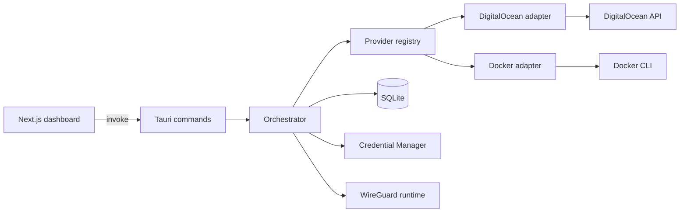

# Architecture

## Overview

GoatStare is a desktop control plane for running user-owned WireGuard VPN infrastructure through provider adapters.

Stack:

- Next.js + React frontend for operator workflows
- Tauri command bridge for typed frontend/backend calls
- Rust backend for orchestration, provider adapters, lifecycle state, and diagnostics
- SQLite for local metadata and runtime snapshots
- Windows Credential Manager for secret storage

Included provider adapters:

- DigitalOcean adapter for cloud VPS lifecycle
- Docker adapter for local container-backed development workflows

## System Diagram

## Core Responsibilities

- Frontend: user workflows for provider, node, tunnel, health, and diagnostics.
- Command layer: typed boundary and error mapping.
- Orchestrator: lifecycle transitions, idempotency, reconciliation, cleanup.
- Provider registry: adapter resolution by provider slug.
- Provider adapters: unified contract for validate, catalog, create, wait, delete.
- WireGuard manager: import, activate, deactivate, remove local tunnel interfaces.

## Lifecycle Model

### Node states

- `new`
- `provisioning`
- `bootstrapping`
- `ready`
- `connected`
- `error`
- `deleting`

### Tunnel states

- `new`
- `ready`
- `connected`
- `disconnected`
- `error`
- `deleting`

State changes are validated in backend transition guards.

## Trust Boundaries

- Frontend input boundary: all command inputs are treated as untrusted.
- Secret boundary: secure storage keeps secret values out of SQLite.
- Provider boundary: remote API responses are validated and normalized.
- Local runtime boundary: WireGuard and Docker command output is treated as untrusted process output.

## Data Flow

1. Register and validate provider credentials.
2. Fetch region and pricing catalog.
3. Provision node and wait for readiness.
4. Generate/import/activate client tunnel.
5. Poll health and diagnostics.
6. Disconnect, destroy, or force-cleanup as required.

## Reliability Patterns

- Idempotent cleanup semantics for partial failures.
- Startup reconciliation for stale local/remote state.
- Explicit recovery flows in the UI for provider and WireGuard failures.
